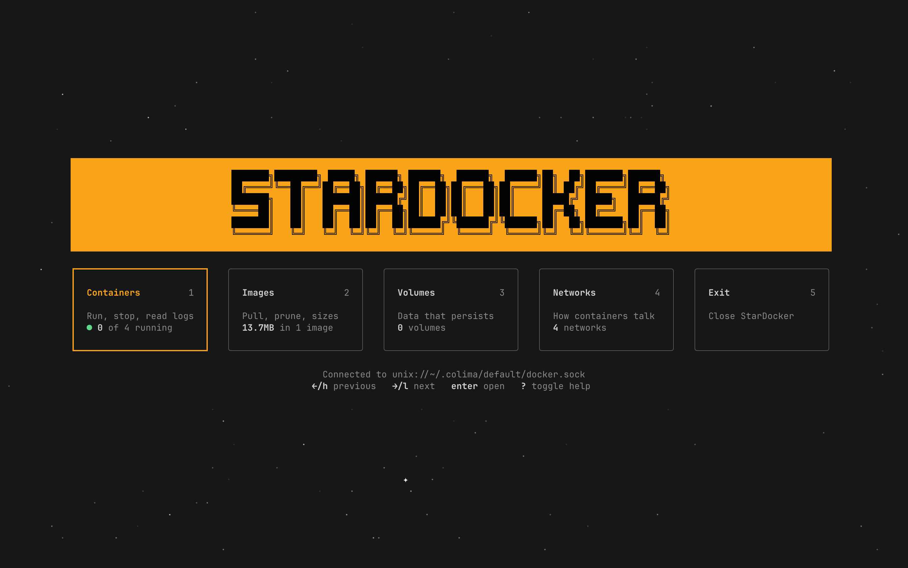
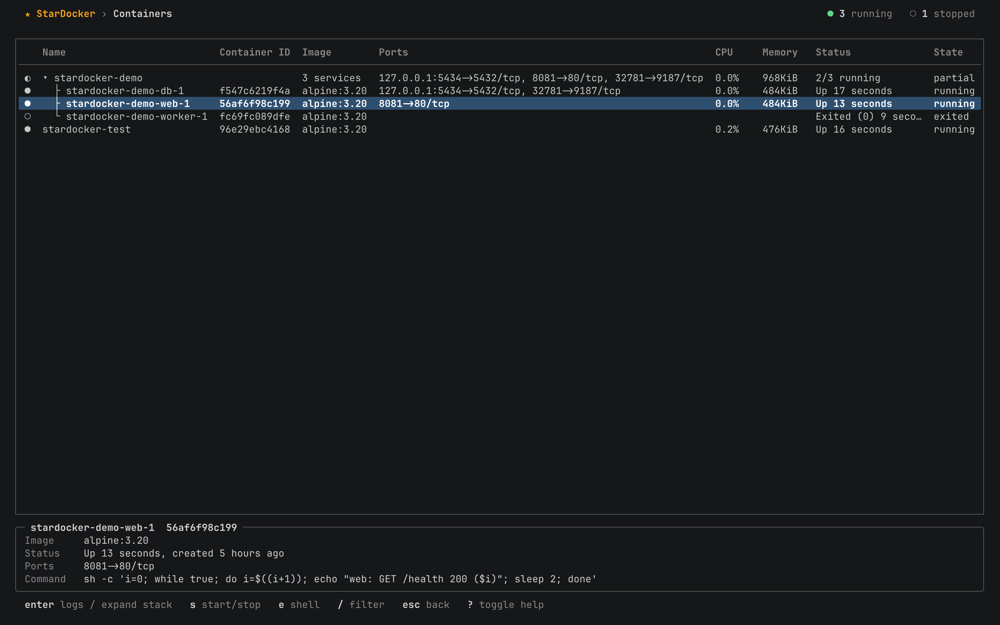
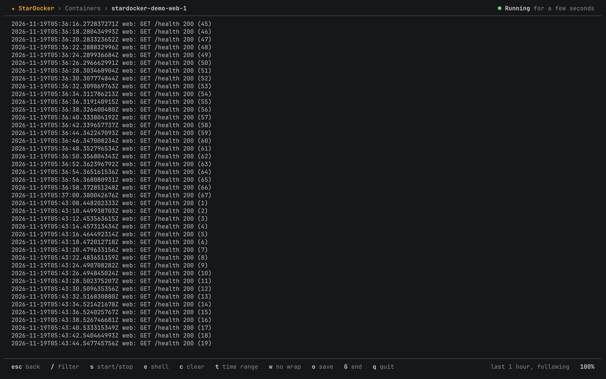
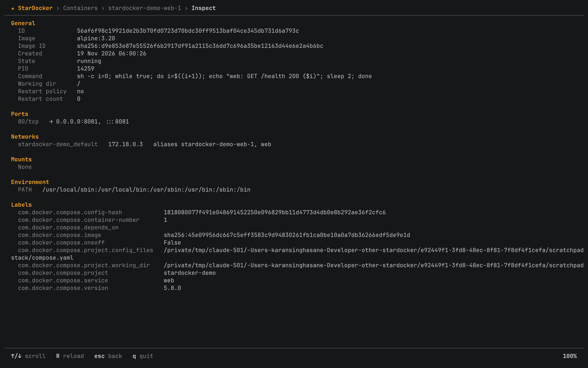
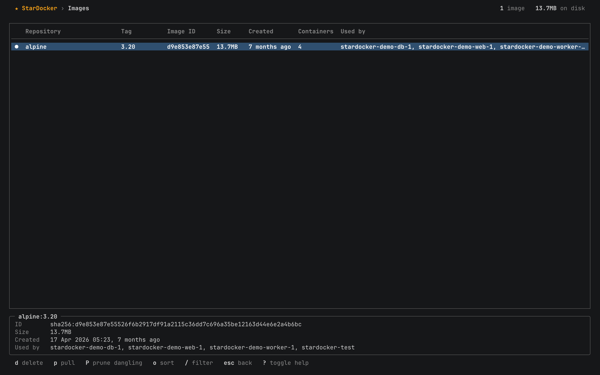
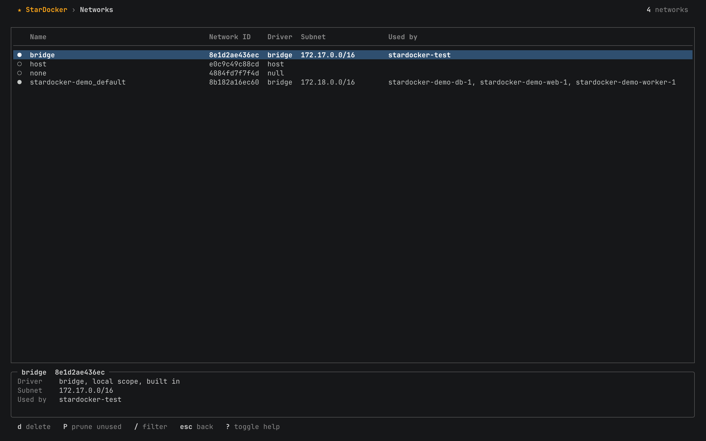

<div align="center">



# ★ StarDocker

**Your whole local Docker setup, one keystroke away.**

A fast, keyboard-driven terminal UI for containers, Compose stacks, logs, images, volumes and networks.

[](https://github.com/stardust1420/stardocker/actions/workflows/ci.yml)
[](https://github.com/stardust1420/stardocker/releases/latest)
[](https://go.dev)
[](https://www.docker.com/)
[](LICENSE)

[Install](#-install) · [Tour](#-a-quick-tour) · [Keys](#%EF%B8%8F-keybindings) · [How it works](#-under-the-hood)

</div>

---

Stop juggling `docker ps`, `docker logs -f`, `docker exec -it` and `docker compose` in five terminal tabs. StarDocker puts everything on one screen: see what's running and how much CPU and memory it's using, follow its logs, open a shell in it, and clean up what you no longer need, all without touching the mouse.

```bash
go install github.com/stardust1420/stardocker@latest && stardocker
```

## ✨ Highlights

- 📊 **Live CPU and memory** for every running container, refreshed every second, summed for Compose stacks
- 🗂️ **Compose-aware**: services are grouped under their project. Expand a stack, or start, stop and restart it as one
- 📜 **Logs that keep up**: streams new lines as they're written, filters and highlights as you type, survives container restarts, saves to a file
- 🐚 **Shell in with `e`**: drops you into `bash` (or `sh`) inside the container, and back into the app when you exit
- 🔍 **Inspect**: environment, ports, networks, mounts, labels and restart policy, laid out to read rather than as raw JSON
- 🧹 **Clean up safely**: delete or prune containers, images, volumes and networks. Every destructive action asks first, and anything still in use is protected
- 🔎 **Filter and sort everywhere**: `/` on any list, `o` to sort by CPU, memory, size or age
- 🚀 **Starts Colima for you** if the daemon is down. Works just as well with Docker Desktop, OrbStack, Rancher Desktop or plain Docker Engine
- 🌌 **A home screen with a sky**: parallax stars, twinkles and the occasional shooting star (or keep them still with `STARDOCKER_REDUCED_MOTION=1`)

---

## 📸 A quick tour

### Containers

Every container, with Compose stacks folded into one row you can expand. The state column tells you at a glance: `●` running, `◐` paused or a partly running stack, `○` stopped. The panel underneath shows the selected row in full, so nothing is lost to truncation.



### Logs

Press `Enter` on a container. You get the last hour (change it with `t`), and new lines stream in live. Filter with `/`, clear the screen with `c` to watch only fresh output, save with `o`, or start, stop and shell into the container without leaving the view.



### Inspect

Press `i` for everything Docker knows about a container, grouped into sections.



### Images

Sizes, age and exactly which containers use each image. Press `p` to pull (it's pre-filled with the selected image, so `p` `Enter` updates it) and `P` to prune dangling layers.



### Volumes and networks

See which containers are attached to what, and delete whatever nothing uses.



---

## 📦 Install

StarDocker needs a running Docker daemon: Docker Desktop, Colima, OrbStack, Rancher Desktop or Docker Engine on Linux. It connects through `DOCKER_HOST`, or the current `docker context`. Opening a shell in a container (`e`) also needs the `docker` CLI on your `PATH`.

**Prebuilt binaries** for Linux, macOS and Windows (amd64 and arm64) are on the [latest release](https://github.com/stardust1420/stardocker/releases/latest). Extract the archive and put `stardocker` on your `PATH`.

**With Go 1.24+:**

```bash
go install github.com/stardust1420/stardocker@latest
```

**From source:**

```bash
git clone https://github.com/stardust1420/stardocker.git
cd stardocker
go build .
./stardocker
```

## 🚀 Usage

```bash
stardocker            # start the app
stardocker --version  # print the version
stardocker --help     # flags and environment variables
```

If the daemon isn't reachable, [Colima](https://github.com/abiosoft/colima) is installed and `DOCKER_HOST` isn't set, StarDocker runs `colima start` and tries again. Configure the VM (type, CPUs, memory) in your Colima config. Otherwise it tells you how to start Docker.

| Environment variable | Effect |
|:--|:--|
| `DOCKER_HOST` | Daemon to connect to (otherwise the current `docker context`) |
| `STARDOCKER_REDUCED_MOTION=1` | Keep the home screen's starfield still |

---

## ⌨️ Keybindings

Press `?` on any list to see every key for that screen.

### Home

| Key | Action |
|:----|:-------|
| `←`/`h`, `→`/`l`, `Tab`/`Shift+Tab` | Move between cards |
| `Enter`/`Space` or `1`–`5` | Open a card |
| `q` | Quit |

### Every list

| Key | Action |
|:----|:-------|
| `↑`/`k`, `↓`/`j` | Move |
| `/` | Filter as you type (`Enter` keeps it, `Esc` clears it) |
| `d` | Delete the selected item (asks first) |
| `P` | Prune everything unused on this screen (asks first) |
| `Esc` | Clear the filter, or go back |
| `?` | Show all keys |
| `q` | Quit |

### Containers

| Key | Action |
|:----|:-------|
| `Enter` | Open logs, or expand/collapse a Compose stack |
| `s` | Start or stop. On a stack: stop every running service, or start them all if none is running |
| `r` | Restart (on a stack: every service that isn't paused) |
| `p` | Pause or unpause |
| `e` | Open a shell in the container |
| `i` | Inspect |
| `o` | Sort by name, CPU, memory or newest |
| `a` | Show running containers only |
| `P` | Delete all stopped containers |

- CPU is per core, so 200% means two full cores. It appears one second after memory, because it's measured between two samples.
- Deleting a running container force-removes it (the prompt warns you). Deleting a stack row deletes all its containers. Volumes are always kept.

### Logs

| Key | Action |
|:----|:-------|
| `/` | Show only matching lines, highlighted |
| `t` | How many hours back to show (decimals work: `0.5` is 30 minutes) |
| `c` / `a` | Clear the view to see only new output / bring the time range back |
| `w` | Toggle line wrapping (`←`/`→` scroll sideways when off) |
| `o` | Save the shown lines to `<container>-<time>.log` in the current directory |
| `s` | Start or stop the container |
| `e` | Open a shell in the container |
| `G` | Jump to the end |
| `Esc` | Back to containers, with your place kept |

The view follows the end unless you've scrolled up. The header shows whether the container is running and for how long, or how and when it exited. When a stopped container starts again, its new output streams in on its own.

### Inspect

| Key | Action |
|:----|:-------|
| `↑`/`↓` | Scroll |
| `R` | Reload |
| `Esc` | Back to containers |

### Images

| Key | Action |
|:----|:-------|
| `p` | Pull an image, with live progress |
| `o` | Sort by name, size or newest |
| `d` | Delete the image, or only the selected tag if it has others |
| `P` | Delete dangling (untagged, unused) images |

An image that containers still use can't be deleted. Delete those containers first.

### Volumes and networks

`d` deletes a volume or network that nothing uses, and `P` deletes every unused one. Pruning volumes deletes their data for good, named volumes included, and the prompt says so. Docker's built-in `bridge`, `host` and `none` networks can't be deleted.

---

## 🔧 Under the hood

StarDocker talks to the Docker Engine API directly through the [Docker Go SDK](https://github.com/docker/go-sdk). There's no background service and nothing to configure. Each screen is its own [Bubble Tea](https://github.com/charmbracelet/bubbletea) model with its own refresh loop, so lists update every second and stop polling the moment you leave them.

```
stardocker/
├── main.go                  # Flags, Docker connection (with Colima fallback), TUI bootstrap
└── src/
    ├── index.go             # Home screen cards
    ├── starfield.go         # Animated home background
    ├── containers.go        # Container list, Compose grouping, filter and sort
    ├── container_actions.go # Start/stop/restart/pause, shell, prune
    ├── stats.go             # Live CPU and memory
    ├── logs.go              # Log viewer
    ├── logstream.go         # Following log stream
    ├── inspect.go           # Container inspect view
    ├── images.go            # Images: list, pull, delete, prune
    ├── volumes.go           # Volumes
    ├── networks.go          # Networks
    ├── input.go             # Text field and "/" filter
    ├── confirm.go           # Confirmation prompts and status messages
    ├── layout.go            # Palette and shared screen layout
    ├── columns.go           # Fits table columns to the terminal width
    ├── details.go           # Details panel for the selected row
    ├── styles.go            # Table styles
    └── help.go              # Keybindings and help
```

### Built with

- [Bubble Tea](https://github.com/charmbracelet/bubbletea): the Elm-inspired TUI framework for Go
- [Bubbles](https://github.com/charmbracelet/bubbles): tables, viewports, help and key bindings
- [Lip Gloss](https://github.com/charmbracelet/lipgloss): terminal styling and layout
- [Docker Go SDK](https://github.com/docker/go-sdk): Docker Engine API client

## 🤝 Contributing

Issues and pull requests are welcome. Before opening a PR:

```bash
gofmt -l .
go vet ./...
go test ./src/...
```

## 📄 License

[MIT](LICENSE)

<div align="center">

Made with ☕ and Go

</div>
